<!-- animated contribution graph: real data, boxes reveal cell by cell
     (regenerated daily by .github/workflows/update-profile-art.yml) -->

<h3><code>mohanaditya@github ~ $ ./contributions.sh</code></h3>

 
 

<h3><code>mohanaditya@github ~ $ whoami</code></h3>

<table width="100%">
<tr>
<td width="50%" valign="top"></td>
<td width="50%" valign="top"></td>
</tr>
</table>

 
 

<h3><code>mohanaditya@github ~ $ ./links.sh</code></h3>

<b>Student-Founder · AI Builder · Entrepreneur 🇮🇳</b>

<b>Founder @ <a href="https://profeshare.ai">Profeshare AI</a> & <a href="https://clearroute.profeshare.ai">ClearRoute</a>  </b>

<b>Also building <a href="https://freebuff-focus.vercel.app">Freebuff-Focus</a>, <a href="">Remarkable AI</a>, <a href="">Tiny Lotus</a>  </b>

 

